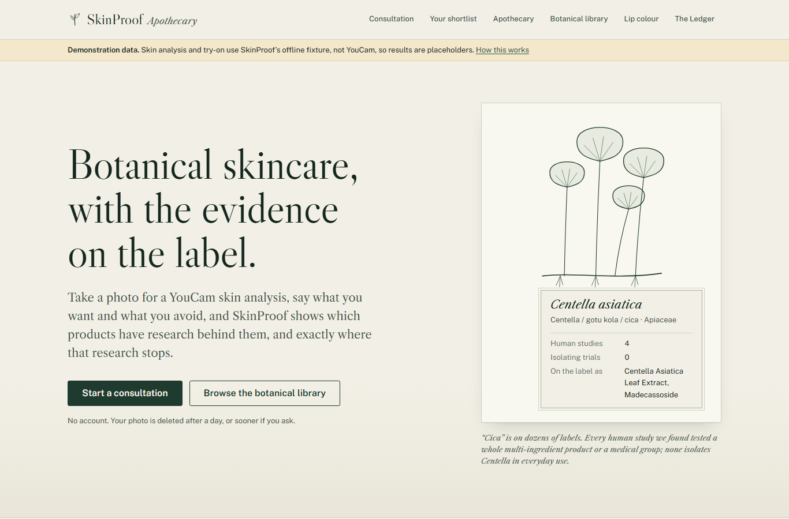
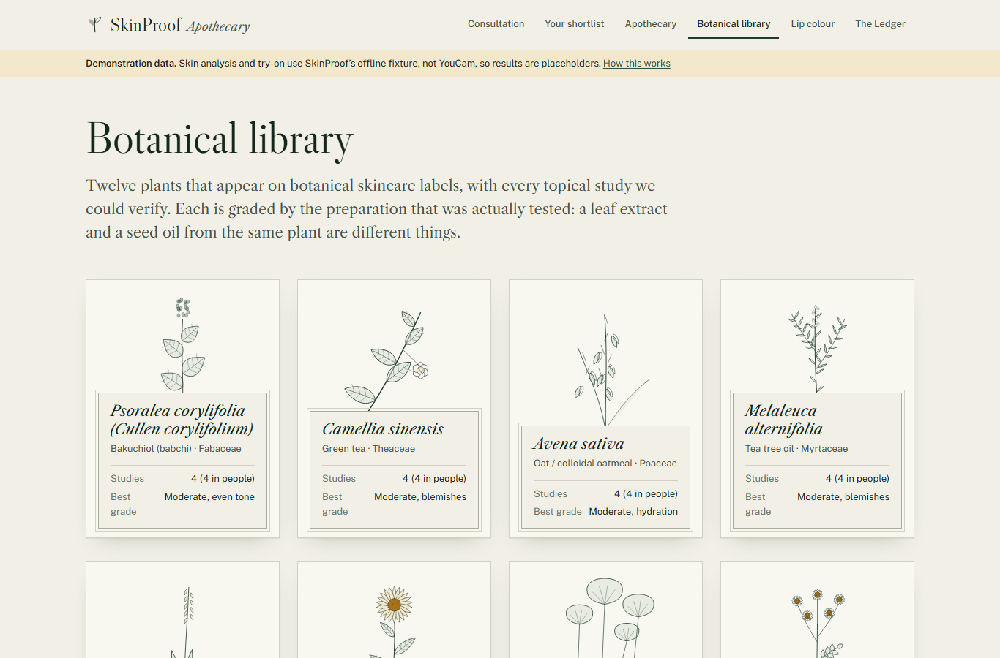
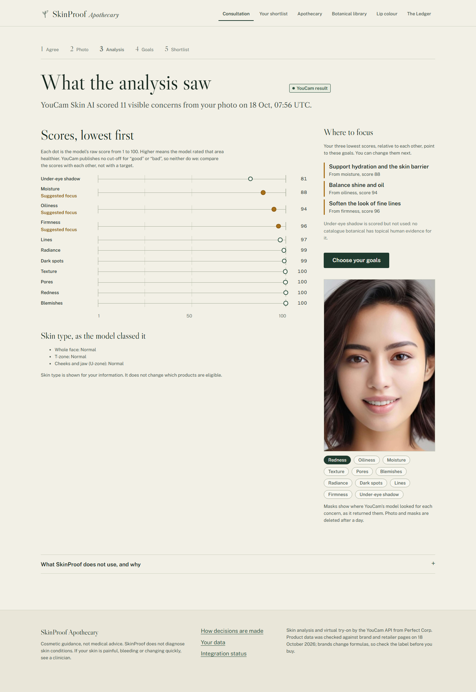
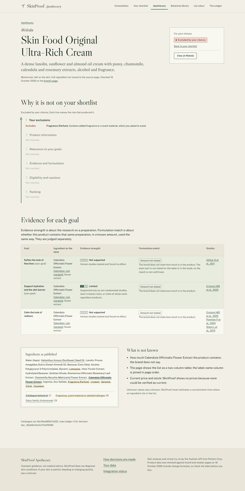
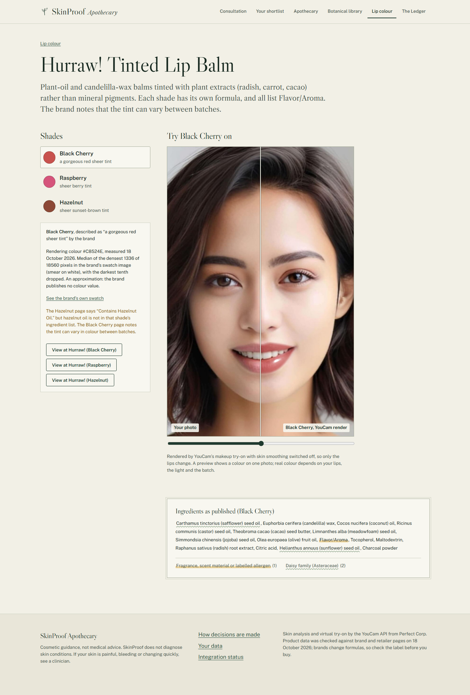

# SkinProof Apothecary

Evidence-led botanical skincare discovery, built on the **YouCam AI Skin
Analysis** and **YouCam AI Makeup Virtual Try-On** APIs.

> Understand your skin. Explore botanical evidence. Discover products whose
> reasoning you can inspect.

“Natural” skincare borrows authority from ingredients: centella, green tea,
bakuchiol. The research behind those names usually tested a different
preparation, at a strength the product never states, sometimes in a medical
setting, often as part of a whole multi-ingredient formula. A shopper cannot
see any of that from a product page.

SkinProof analyses a selfie with YouCam Skin AI, asks what the person wants and
what they will not use, and runs every product in a curated catalogue through
the **Botanical Evidence Ledger**: a deterministic, published set of rules that
decides which products are eligible, in what order, and why the others were set
aside. For tinted lip balms, YouCam's makeup try-on shows the shade on the
person's own photo, with skin smoothing switched off.

Entry for the [YouCam API Skin AI & eCommerce VTO Hackathon](https://youcam-api-skin-ai-ecommerce.devpost.com/)
(Skin AI topic; deadline 2 November 2026).

## Status, stated plainly

| | |
| --- | --- |
| YouCam integration | **Verified live on 18 October 2026.** One Skin Analysis (12 SD concerns, 14 units) and one lip try-on (1 unit) through SkinProof’s own adapters, then one full journey in the app in live mode. Responses matched the documented shapes; detection masks align with the photo; the try-on changed 1.35 % of pixels, all over the mouth. 30 units in total. Record: [docs/API-VERIFICATION.md](docs/API-VERIFICATION.md) |
| Scope of that check | One portrait (YouCam’s own documentation sample) and one shade. It shows the integration works, not how the model behaves across faces, skin tones or light |
| Everything else | Implemented and tested end to end, also with a clearly labelled offline fixture provider for development and judging without a key |
| Screenshots below | The analysis and try-on images are **live YouCam output** on the documentation sample portrait. A full fixture-mode set is in `docs/screenshots/fixture-*` |
| Catalogue | 12 botanicals, 44 PubMed-verified topical studies, 22 skincare products and 3 lip tints, ingredient lists checked against brand pages on 18 October 2026 |

Live checks spend YouCam units and are run only with the owner's explicit
approval (`npm run verify:live`, see below).

## The journey

1. **Agree.** A short, specific consent: what is sent to YouCam, what SkinProof
   keeps and for how long. Skipping the photo is always possible.
2. **Photo.** Upload, with a keyboard-operable crop so the face fills the frame
   as the API requires. Metadata (location, device) is stripped first.
3. **Analysis.** YouCam Skin AI scores 11 visible concerns plus skin type.
   SkinProof shows the model's **raw** scores relative to each other (YouCam
   publishes no cut-offs, so neither do we), suggests the three lowest as focus,
   and overlays the detection masks. It ignores the deliberately flattering
   “UI score”, the “skin age” and the overall score.
4. **Goals and limits.** Up to three cosmetic goals (suggested ones arrive
   ticked, with their reason) and hard limits: no fragrance, no essential oils,
   no labelled fragrance allergens, no daisy-family plants, named ingredients.
5. **Shortlist.** The Ledger's decision: ranked eligible products, every
   set-aside product grouped by reason, and the decision's provenance (rule
   version, catalogue version, inputs hash). If nothing qualifies, it says so
   and names goals that would have matches.
6. **Evidence Dossier.** For each product: the stage-by-stage reasons, evidence
   strength and formulation match side by side for every goal, the ingredient
   list exactly as published with SkinProof's readings marked on it, and a list
   of what is not known.
7. **Compare** two to four products on the same rows.
8. **Lip colour.** Try a tinted balm's shade on your photo. Shades that break
   your limits, or that have no brand swatch to take a colour from, cannot be
   tried on.

## The Botanical Evidence Ledger

Three assessments are kept separate:

* **Evidence strength**: for one botanical *preparation* and one goal, from the
  studies of that preparation. Only randomised trials in everyday cosmetic use
  that isolate the botanical count as full trials; studies of whole products and
  short irritation tests count at most as “limited”; medical-setting studies
  are shown but not counted.
* **Formulation match**: does the product contain that same preparation, in a
  stated amount at least as high as studied, used the same way? Concentration
  is never inferred from list position.
* **Eligibility**: hard exclusions first (nothing can override them), then
  product verification, relevance, a qualifying evidence link, cautions, and a
  lexicographic ranking with ties reported.

Full rules: [docs/LEDGER.md](docs/LEDGER.md), the in-app `/ledger` page, and
[src/lib/ledger/engine.ts](src/lib/ledger/engine.ts).

## Screenshots

| | |
| --- | --- |
|  |  |
| Landing: a herbarium plate whose label carries real catalogue counts | Botanical library, graded per preparation |
|  |  |
| Live YouCam Skin Analysis: raw scores, focus, skin type, masks | The Ledger's shortlist from that analysis, with provenance |
|  |  |
| A dossier: excluded at stage one by a hard limit | Live YouCam lip try-on, skin smoothing off |

The portrait is the sample image from YouCam's own API documentation. More in [docs/screenshots](docs/screenshots).

## Architecture

One Next.js 16 application (App Router, Node runtime), SQLite through Drizzle,
sharp for images, zod at every trust boundary. Much of the infrastructure is
ported from the author's TryOn project (see “What was reused”).

| Layer | Where | Responsibility |
| --- | --- | --- |
| Experience | `src/app`, `src/components` | Pages, forms, loading, empty, error and retry states. Renders decisions; never makes them |
| Orchestration | `src/app/actions.ts`, `src/lib/services` | Consent, photo storage, analysis and try-on jobs, decisions, retention, unit budget |
| Provider integration | `src/lib/providers` | Shared YouCam client; Skin Analysis and Makeup VTO adapters; labelled fixtures |
| Domain model | `src/lib/domain` | Concerns, goals, profile, try-on payload |
| Decision engine | `src/lib/ledger` | The Botanical Evidence Ledger: pure, deterministic functions and the rule register |
| Catalogue | `src/data/catalogue`, `src/lib/catalogue` | Curated JSON, validated and cross-checked at start-up |
| Persistence | `src/lib/db`, `drizzle/`, `src/lib/storage` | Consultations, analyses, decisions, previews; content-addressed images with deletion |

Decisions and trade-offs: [docs/TECHNICAL-DECISIONS.md](docs/TECHNICAL-DECISIONS.md).

## Run it

Requirements: Node.js 20.9 or later. No other services.

```bash
npm ci
```

```bash
cp .env.example .env.local
```

```bash
npm run dev
```

Open http://localhost:3000. With `PROVIDER_MODE=fixture` (the default)
everything works offline, and every analysis and try-on result is labelled as
a fixture. `better-sqlite3` and `sharp` ship prebuilt binaries; `.npmrc` skips
install scripts so no C++ toolchain is needed.

The database is created and migrated on first use (`npm run db:migrate` does it
explicitly). Data lives in `DATA_DIR` (default `./data`).

Production: `npm run build` then `npm start`. Behind plain http on a non-local
host, set `SKINPROOF_INSECURE_COOKIES=1` or the session cookie will not be set;
use https instead where you can.

### Deploying

SkinProof keeps its database and images on disk and runs analysis jobs inside
the server process, so deploy it as one long-running Node service with a
persistent disk (a VM, or a container host such as Render or Railway with a
volume mounted at `DATA_DIR`). Serverless platforms that discard the
filesystem between requests are not suitable. Build with `npm run build`, start
with `npm start` (it honours `PORT`), and check `GET /api/health`. For a public
judging copy, leave `PROVIDER_MODE=fixture`, or use live mode with a small
`LIVE_DAILY_UNIT_BUDGET` and an `APP_ACCESS_CODE` shared in the testing
instructions.

The public judging copy is https://skinproof-apothecary.onrender.com (health
check: https://skinproof-apothecary.onrender.com/api/health). It runs on
Render's free plan in fixture mode, with no YouCam key and no access code, so
it spends no units and every analysis and try-on result is a labelled
placeholder. The free plan has no persistent disk, so it is set up differently
from the advice above:

- the first load after 15 minutes idle takes about a minute while the service
  wakes;
- consultations are reset whenever the service sleeps or redeploys.

What the real YouCam service returns is shown in the live screenshots
(`docs/screenshots/live-*`) and the live verification record
(`docs/API-VERIFICATION.md`).

### Live mode

Put a YouCam API key in `.env.local` (from
https://yce.makeupar.com/api-console/en/api-keys/) and set `PROVIDER_MODE=live`.
Each analysis costs about 14 units and each try-on 1. `LIVE_DAILY_UNIT_BUDGET`
caps the server's daily spend, and `APP_ACCESS_CODE` gates live features on a
hosted copy.

### Live checks (units are spent only with `--spend`)

```bash
npm run verify:live -- credits
```

```bash
npm run verify:live -- skin --image path/to/your-own-portrait.jpg --crop 0.15,0.12,0.73,0.85 --spend
```

```bash
npm run verify:live -- tryon --image path/to/your-own-portrait.jpg --shade hurraw-tinted-lip-balm/black-cherry --spend
```

Without `--spend` the script prints the exact plan and expected units and sends
nothing.

## Test it

```bash
npm test
```

```bash
npm run typecheck
```

```bash
npm run test:e2e
```

```bash
npm run catalogue:check
```

* `npm test`: 83 unit and integration tests. They cover the Ledger rules, label
  reading, focus suggestion, image normalisation, adapter contract tests with a
  scripted fetch (no network), the service journey, and Ledger invariants on
  the real catalogue.
* `npm run test:e2e`: 18 Playwright tests against a production build in fixture
  mode, desktop and phone.
* `npx tsx scripts/verify-citations.ts` re-checks all 44 PubMed citations (needs network).
* `npm run screenshots` regenerates the screenshots from a production build.

Record of runs: [docs/TESTING.md](docs/TESTING.md).

## Data and privacy

Photos and derived images are deleted after 24 hours (configurable), whole
consultations after 30 days, and everything at once from the “Your data” page.
YouCam's raw responses are never stored. Details: [docs/PRIVACY.md](docs/PRIVACY.md).

## What was reused, and what is new

SkinProof started on 18 October 2026, inside the hackathon's submission period.
It ports infrastructure from **TryOn**, the same author's lipstick try-on QA tool
(a separate entry): the YouCam File/task/poll/download client (generalised here
for two APIs), image normalisation, the content-addressed image store, the
SQLite/Drizzle setup and the testing setup. Everything else is new: the Skin
Analysis adapter, the Ledger, the curated catalogue and its research, every
page and the design system.

## Known limitations

* Live behaviour has been checked on one portrait and one shade only.
* The catalogue is small and curated by hand. Product formulas change, so each
  record carries the date it was checked.
* Most botanical evidence is weak. The Ledger shows that rather than hiding it,
  so many goals end with “limited” evidence or no match.
* Try-on colours are measured from brand swatch images and are approximations;
  sheer balms look different on different lips.
* One consultation per browser, no accounts. Jobs run inside the web process.
* Cosmetic guidance only, not medical advice.

## Documentation

[Hackathon requirements](docs/HACKATHON-REQUIREMENTS.md) ·
[API verification](docs/API-VERIFICATION.md) ·
[Ledger](docs/LEDGER.md) ·
[Catalogue method](docs/CATALOGUE-METHOD.md) ·
[Technical decisions](docs/TECHNICAL-DECISIONS.md) ·
[Privacy](docs/PRIVACY.md) ·
[Design system](docs/DESIGN-SYSTEM.md) ·
[Testing](docs/TESTING.md) ·
[Demo script](docs/DEMO-SCRIPT.md) ·
[Submission text](docs/SUBMISSION.md)

## Licence

MIT. Product names belong to their owners and appear only as factual catalogue
entries. No brand imagery is included; the botanical drawings are original.
